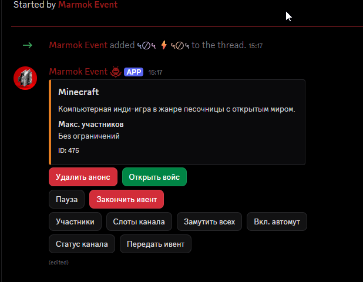
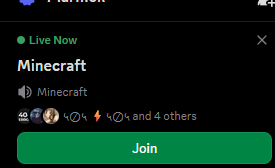
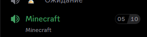

# Marmok Bots

Public privacy policies and demonstration materials for Marmok Discord bots. This repository contains public documentation and screenshots; it does not contain bot credentials or application databases.

## Marmok Event

Marmok Event helps hosts and moderators run community events using slash commands, buttons, dedicated event channels and management threads. It integrates with Discord Scheduled Events and an event dashboard.

- Application ID: `1486027665751281837`
- [Privacy Policy](PRIVACY.md)
- Private privacy/support contact: [Telegram @sufferedk1d](https://t.me/sufferedk1d)

## Screenshots

### Event management thread and control panel

The thread notice shows the bot adding a member. The panel includes event announcements, voice channel controls, participant lists, pause/finish controls and host transfer. The underlying staff workflow adds members of configured roles to the management thread using the guild member cache.

### Live scheduled event

Discord displays the active Minecraft event with a Join button. This illustrates the scheduled event integration.

### Event voice channel

The Minecraft voice channel displays participant slots. Attendance is processed through voice state events.

The scheduled event and voice channel screenshots provide event context; they are not evidence of online presence tracking or message content processing.

## Other Marmok bots

Documentation and demonstration materials for additional bots can be added here. Each bot should have an accurate description of its own data practices; the current privacy policy documents Marmok Event.

## Contact

Use [Issues](https://github.com/sufferedkid/marmok-bots/issues) for general questions about these public documents. Issues are public; use the private contact above for account-specific privacy requests and do not post personal data, credentials or private conversations.
